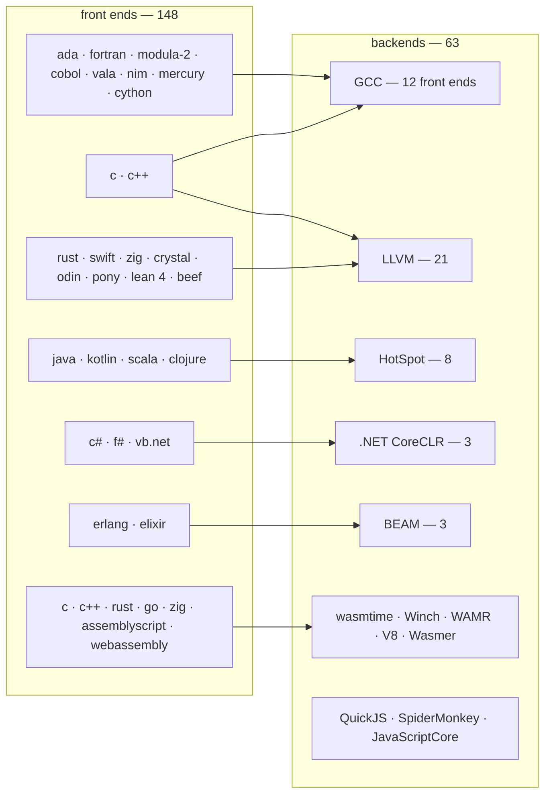

# StUpIdSpEeD (programming language speed benchmark)

Measures the speed of programming languages in the simplest ways possible.

15 tiny tasks, written in every language below, timed and compared.
The code is AI generated by an LLM from the specs in this file.

## Two axes: 147 front ends, 63 backends

The matrix has two axes and the results are reported on both.

- A **front end** is a language and the toolchain that compiles, JITs or interprets
  it: `Ada`/`gnat`, `C`/`gcc`, `C++`/`g++`, `Rust`/`rustc`, `Swift`/`swiftc`. There
  are **147** of them here, over **58** languages.
- A **backend** is what actually executes the result: the code generator or virtual
machine the front end hands its program to. There are only **63**, and five of
  them carry 59 of the 147 front ends — **LLVM** 21, **GCC** 12, **V8** 11,
  **wasmtime** Cranelift 8 and **wasmtime** Winch 7. Twelve more carry 2-6 each — the
  JVM's **HotSpot** family (8 front ends over four of them), .NET's **CoreCLR** (3) and
  the **BEAM** (3) among them, 43 front ends between them — and the remaining 46 carry
  exactly one front end apiece, which is 148 placements in all because Luau's single
  toolchain runs on two of them.



`ada`, `fortran`, `cobol`, `vala`, `nim`, `mercury` and `cython` are all GCC, as are the
`c` and `c++` rows, Haxe's `hxcpp` and Python's `nuitka`; `java`, `kotlin`, `scala` and
`clojure` are all HotSpot; `c#`, `f#` and `vb.net` are all CoreCLR. Comparing two front
ends on one backend measures what the language costs before the backend sees it — `ada`
against `c` on GCC.
Comparing two backends measures the backend — `c` on gcc against clang and msvc, or
one WebAssembly module on six backends — wasmtime's two compilers, Wasmer's two,
WAMR and node's V8 — with the front end held perfectly fixed.

Every table below carries both. `exec/cells.json` is the registry that assigns a
backend to every toolchain, `exec/harness.py --backends` prints the two axes side by
side, and `--backend gcc` runs one backend's front ends. See [Results](#results).

What you need installed to build the programs is in `BUILD.md`, and what you need to
run them is in `RUN.md`.

## What is in the repository

| Path | What it is |
|---|---|
| `sources/<row>/` | the fifteen task programs for every row, as written |
| `exec/<row>/` | the same rows built: each task's compiled program or staged script, plus that row's `build_all.bat`/`run_all.bat` and `verify.py` |
| `exec/harness.py` | the test harness: runs every built program in `exec/`, N times each, and records speed, peak memory and program size |
| `exec/cells.json` | the harness's registry: how to run each of the 2205 cells, transcribed from the row verifiers, plus the backend table that says what actually executes each one |
| `exec/plot.py` | turns `results.json` into `results.html`: ranked bars, an overall ranking of every toolchain by rank sum, mean rank or suite time, an all-task matrix and trend comparisons, with full measurement records |
| `data.bin` | the 50 MiB fixture tasks 14 and 15 use, committed once at the root |
| `BUILD.md`, `RUN.md` | how each row is built, and how it is run |

The built programs are committed, so a checkout can be verified without installing anything
first — that is what `exec/<row>/verify.py` does, one row at a time. They are 4.39 GB across
23 320 unique files; the paths number 37 845, because a build stages its own copies of the
task sources and of the fixture, and git stores one blob per distinct content.

One row's output is a *directory* package rather than a single file — the ActionScript row's
`out\` — and the AIR runtime validates the bytes inside it, so `.gitattributes` marks those
directories `-text` and they are checked out exactly as committed. A checkout that
line-ending-converts them fails every ActionScript cell with `invalid license or package`;
`RUN.md` has the measurements and the one-line repair for an older clone.

`exec/harness.py` runs all of them and measures them. It reads the cell registry at
`exec/cells.json` — how to invoke each of the 2205 cells, transcribed from the row verifiers,
which stay the authority on how a row is built and run — runs each cell `--runs` times (once by default), and
writes `exec/results.json` (every sample) and `exec/results.md` (the speed, peak-memory and
program-size tables below, in the same shape as the results table, each grouped by backend).

```
python exec/harness.py                       # the whole matrix, one timed run a cell
python exec/harness.py --runs 5              # five timed runs a cell
python exec/harness.py --rows c,rust --tasks 01,07
python exec/harness.py --rows actionscript   # one row, by its folder under exec/
python exec/harness.py --language C++        # every row of one language
python exec/harness.py --backends            # the two axes: backends and their front ends
python exec/harness.py --backend gcc         # one backend's 12 front ends
python exec/harness.py --start 1 --end 200   # items 1-200, by position in --list
python exec/harness.py --rows 1-30           # the first thirty languages
python exec/harness.py --check               # one run each: pass/fail, no timing
python exec/harness.py --list --rows zig     # what would run, without running it
```

Every cell has a number — its position in `--list` order, row then toolchain then task — and
`--start`/`--end` take a slice of the matrix by that number, which is how a full sweep is run
in chunks. `--rows` also takes numbers and ranges, so `--rows 1-30` is the first thirty
languages and `--rows 1-80` is all of them.

A single language is run by naming its folder: `--rows actionscript` is that row's fifteen
cells, in any case and as a path (`--rows exec/ada`, `--rows sources\ada`). A language the
results table splits across rows is run with `--language` and the name that table gives it —
`--language C++` is the `cpp` and `cpp-wasm` rows, `--language Python` is `python`
and `python-cython`. The two are unioned, and a name that matches no
row is an error rather than an empty run: since results are merged, a run that selected
nothing would otherwise look like a run that measured nothing.

`--backend` picks the other axis: it keeps only the front ends that execute on the named
backend, by id or by the display name the tables print (`--backend gcc`, `--backend llvm`,
`--backend "HotSpot C2"`, `--backend beam`). It narrows whatever `--rows`/`--language` named,
the way `--tasks` does, and names toolchains rather than whole rows — the `c` row is four
front ends on four backends, so `--rows c --backend llvm` is that row's clang cells and leaves
its gcc, tcc and msvc cells alone. `--backends` prints the axis without running anything: one
line per backend with its kind and the front ends and languages it carries, biggest first.

**Results are additive.** Each run merges into `exec/results.json` instead of replacing it: a
cell measured again replaces its own older row, a cell not run this time keeps the number it
already had, and `--replace` is there for starting over. So the chunks above build one
complete matrix between them, and a sweep that is interrupted — or killed — is continued with
`--start` rather than repeated. The file is also written atomically and flushed every
`--flush-every` cells (25 by default), so a run cut off mid-way keeps everything it measured
except the last few, instead of losing the lot.

`exec/plot.py` turns that file into `exec/results.html`: one self-contained page, no server
and no network. It opens on ranked horizontal bars with every language/toolchain separate,
including an explicit execution-kind badge (Native AOT, Native JIT, interpreter, etc.).
The metric switches between execution time, wall clock, memory and program size; the
**Include** and **Engine kind** filters narrow which rows appear, and **Reset filters**
clears them. Timing bars are proportional to elapsed time by default: shorter is faster,
and 20 ms is twice the bar length of 10 ms. An explicitly labelled logarithmic view is
available for large ranges. The all-task matrix and zoomable trend view share the filters;
**Details** opens the full record, including every sample, correctness-check flag, timing
source, warnings and errors.

The **Overall ranking** tab ranks one item per front end — a language plus its toolchain, the
matrix's row — over whatever the filters leave, with nothing rolled up: `C`/`gcc`, `C`/`clang`
and `C`/`msvc` are three entries, and none of them stands for all of C. Each item gets a
position per task (1 is the fastest, ties share the better position) and the tab can order by
**rank sum**, by **mean rank** or by **total suite time**, the item's fifteen execution medians
added up. All three are also the three columns: clicking **Rank sum**, **Mean rank** or
**Suite time** sorts by it. For a toolchain measured on all fifteen tasks the first two order
identically — the mean is the sum over a constant 15 — and they part company only in the
incomplete tail, where an item covering twelve tasks has twelve positions to add and divide.
The strip shows the item's position in each task. Only complete items are ranked, because a sum
of positions rewards work that was never done.

```
python exec/plot.py --open                   # results.json -> results.html, and open it
```

For each cell the harness records the program's own `TIME_MS` line — the contract's number,
which excludes start-up — beside the harness's end-to-end wall clock, the child's peak working
set, and the size of the built program. A cell with no `TIME_MS` line is reported with its wall
clock instead, marked `*`; a cell that cannot run on this machine — toolchain absent, or a
runtime it needs not installed — is reported as skipped rather than failed, and one that ran
but crashed after printing its answer is measured with a `!` note. Cells run one at a time,
each pinned to a single core — four for task 11 — and nothing the harness runs writes to a
terminal or can leave a crash dialog waiting for a click.

`tools/` is **not** committed: it is ~28 GB of third-party compilers and runtimes, and
`BUILD.md` lists what to install instead. `temp/` is scratch and is not committed either.

## Results

**147 front ends, 63 backends, 2205 cells.** Every table below is ordered by backend, so all
the front ends that land on one backend sit together, and the `Backend` column repeats on
every line — `grep '^| GCC '` is every row GCC runs, whatever front end is above it.

One front end appears on two backend rows, and only one: **Luau**, which is a single toolchain
whose task set decides which engine runs it. Tasks 01–10, 12 and 13 go to the Luau CLI's own VM
(12 cells, `Luau` below) and tasks 11, 14 and 15 need **Lute**, the Luau team's own runtime,
because the plain CLI has no file I/O and no process API at all — no `io`, no `os.execute`, no
`package` (3 cells, `Lute` below). The split is a property of the tasks, not a choice between
two builds, so the registry registers one toolchain and its cells name the engine that ran
them; the two are not the same backend and their numbers are not comparable.

| Backend | Kind | Front ends | Cells | Languages |
|---|---|---|---|---|
| LLVM | `native-aot` | 21 | 315 | Ada, Beef, C, C++, Crystal, D, Fortran, Go, Kotlin, LLVM IR, Lean 4, Nim, Objective-C, Odin, Pony, Rust, Scala, Swift, Zig |
| GCC | `native-aot` | 12 | 180 | Ada, C, C++, COBOL, Fortran, Haxe, Mercury, Nim, Python, Vala |
| V8 | `native-jit` | 11 | 165 | AssemblyScript, C, C++, Clojure, Go, Haxe, JavaScript, Kotlin, Rust, Scala, Zig |
| wasmtime (Cranelift) | `wasm-runtime` | 8 | 120 | AssemblyScript, C, C++, Go, Lua, Rust, WebAssembly, Zig |
| wasmtime (Winch) | `wasm-runtime` | 7 | 105 | AssemblyScript, C, C++, Go, Rust, WebAssembly, Zig |
| WAMR (iwasm) | `wasm-runtime` | 6 | 90 | AssemblyScript, C, C++, Go, Rust, Zig |
| Wasmer (Cranelift) | `wasm-runtime` | 6 | 90 | AssemblyScript, C, C++, Go, Rust, WebAssembly |
| Wasmer (LLVM) | `wasm-runtime` | 6 | 90 | AssemblyScript, C, C++, Go, Rust, WebAssembly |
| HotSpot (tiered C1 + C2) | `native-jit` | 5 | 75 | Clojure, Haxe, Java, Kotlin, Scala |
| BEAM | `native-jit` | 3 | 45 | Elixir, Erlang |
| CoreCLR | `native-jit` | 3 | 45 | C#, F#, VB.NET |
| MSVC | `native-aot` | 3 | 45 | C, C++, Common Lisp |
| none — hand-written machine code | `assembler` | 3 | 45 | Assembly |
| Chez Scheme | `native-aot` | 2 | 30 | Racket, Scheme |
| GraalVM JIT | `native-jit` | 2 | 30 | Java, Python |
| Mono | `native-jit` | 2 | 30 | C#, Haxe |
| zig cc / zig c++ | `native-aot` | 2 | 30 | C, C++ |
| ADW | `native-aot` | 1 | 15 | Modula-2 |
| AVM2 (AIR) | `native-jit` | 1 | 15 | ActionScript |
| CPython | `bytecode-vm` | 1 | 15 | Python |
| CRuby | `bytecode-vm` | 1 | 15 | Ruby |
| CompCert | `native-aot` | 1 | 15 | C |
| CoreCLR NativeAOT | `native-aot` | 1 | 15 | C# |
| Cranelift (rustc) | `native-aot` | 1 | 15 | Rust |
| DMD | `native-aot` | 1 | 15 | D |
| Dart AOT | `native-aot` | 1 | 15 | Dart |
| Dart VM | `native-jit` | 1 | 15 | Dart |
| FPC | `native-aot` | 1 | 15 | Pascal |
| GHC | `native-aot` | 1 | 15 | Haskell |
| GNU Prolog | `native-aot` | 1 | 15 | Prolog (GNU) |
| GNU R | `bytecode-vm` | 1 | 15 | R |
| Go (gc) | `native-aot` | 1 | 15 | Go |
| Godot | `bytecode-vm` | 1 | 15 | GDScript |
| GraalVM native-image | `native-aot` | 1 | 15 | Java |
| HashLink | `bytecode-vm` | 1 | 15 | Haxe |
| HotSpot (interpreter) | `bytecode-vm` | 1 | 15 | Java |
| HotSpot C1 | `native-jit` | 1 | 15 | Java |
| HotSpot C2 | `native-jit` | 1 | 15 | Java |
| Intel oneAPI (DPC++) | `native-aot` | 1 | 15 | C |
| JavaScriptCore | `native-jit` | 1 | 15 | JavaScript |
| LLVM (JIT) | `native-jit` | 1 | 15 | Julia |
| LuaJIT | `native-jit` | 1 | 15 | Lua |
| Mono AOT | `native-aot` | 1 | 15 | C# |
| OCaml (ocamlc) | `bytecode-vm` | 1 | 15 | OCaml |
| OCaml (ocamlopt) | `native-aot` | 1 | 15 | OCaml |
| OpenJ9 | `native-jit` | 1 | 15 | Java |
| PUC Lua | `bytecode-vm` | 1 | 15 | Lua |
| Perl | `interpreter` | 1 | 15 | Perl |
| Pharo VM | `native-jit` | 1 | 15 | Pharo |
| Poly/ML | `native-aot` | 1 | 15 | Standard ML |
| PyPy | `native-jit` | 1 | 15 | Python |
| QuickJS | `bytecode-vm` | 1 | 15 | JavaScript |
| SBCL | `native-aot` | 1 | 15 | Common Lisp |
| SWI-Prolog | `bytecode-vm` | 1 | 15 | Prolog (SWI) |
| SpiderMonkey | `native-jit` | 1 | 15 | JavaScript |
| TCC | `native-aot` | 1 | 15 | C |
| Tcl | `bytecode-vm` | 1 | 15 | Tcl |
| Zend | `bytecode-vm` | 1 | 15 | PHP |
| Zend JIT | `native-jit` | 1 | 15 | PHP |
| Zig (self-hosted x86-64) | `native-aot` | 1 | 15 | Zig |
| gforth | `interpreter` | 1 | 15 | Forth |
| Luau | `bytecode-vm` | 1 | 12 | Luau |
| Lute | `native-jit` | 1 | 3 | Luau |

Seventeen of the 63 backends carry more than one front end, and between them they account for
102 of the 148 backend placements; the other 46 carry exactly one apiece, and the 148 exceeds
the 147 front ends only because Luau's single toolchain is on two of them. That is the whole
point of the axis:
**`ada`, `fortran`, `c`, `c++`, `cobol`, `vala`, `nim`, `mercury`,
`cython`, `nuitka` and `haxe`'s hxcpp row are all GCC.** Their
differences are front-end differences — what the language's own semantics cost before the C
compiler sees anything — and none of them is a comparison of code generators. The same is true
of the twenty-one LLVM rows, the three CLR rows, and the three BEAM rows — where `erlang` and
`elixir` are the same VM under two languages, and `erlang`'s two toolchains differ only in
*when* the compile happens, `escript` compiling the script on every run and `erlc` compiling it
once.

### What a backend's kind means

A backend's `kind` says what its measured number contains, and two rows are only comparable
within a kind:

| Kind | What the measured number contains |
|---|---|
| `native-aot` | nothing but the program: the compile finished before the clock started |
| `native-jit` | the VM's compilation of the code it is running, plus the program |
| `wasm-runtime` | the runtime's translation of the module, plus the program |
| `bytecode-vm` | the VM's dispatch on every operation |
| `interpreter` | the interpreter's walk over the source or its tree |
| `assembler` | nothing but the program; there is no compiler in the row at all |

### The matrix

One line per **front end** — a language and the toolchain that builds or runs it — grouped by
backend. The column headings are the task numbers, and the task names are the section headings
under [Tasks](#tasks). All 147 front ends, empty and ready to fill in.

A cell holds the median of its timed runs, in milliseconds — one run per cell by default,
`--runs N` for N. `exec/harness.py` writes the
same table with the numbers in it to `exec/results.md`, preceded by a per-backend rollup, and
`exec/plot.py` shows the same matrix with every toolchain individual, carrying its
execution-kind label. Colours identify backend kinds in the rankings and trend chart.

| Backend | Language | Toolchain | 01 | 02 | 03 | 04 | 05 | 06 | 07 | 08 | 09 | 10 | 11 | 12 | 13 | 14 | 15 |
|---|---|---|---|---|---|---|---|---|---|---|---|---|---|---|---|---|---|
| ADW | Modula-2 | adw |  |  |  |  |  |  |  |  |  |  |  |  |  |  |  |
| AVM2 (AIR) | ActionScript | AIR |  |  |  |  |  |  |  |  |  |  |  |  |  |  |  |
| BEAM | Elixir | elixir (BEAM) |  |  |  |  |  |  |  |  |  |  |  |  |  |  |  |
| BEAM | Erlang | erlc (compiled) |  |  |  |  |  |  |  |  |  |  |  |  |  |  |  |
| BEAM | Erlang | OTP (escript) |  |  |  |  |  |  |  |  |  |  |  |  |  |  |  |
| Chez Scheme | Racket | racket (CS) |  |  |  |  |  |  |  |  |  |  |  |  |  |  |  |
| Chez Scheme | Scheme | chez |  |  |  |  |  |  |  |  |  |  |  |  |  |  |  |
| CompCert | C | compcert |  |  |  |  |  |  |  |  |  |  |  |  |  |  |  |
| CoreCLR | C# | coreclr |  |  |  |  |  |  |  |  |  |  |  |  |  |  |  |
| CoreCLR | F# | dotnet |  |  |  |  |  |  |  |  |  |  |  |  |  |  |  |
| CoreCLR | VB.NET | dotnet |  |  |  |  |  |  |  |  |  |  |  |  |  |  |  |
| CoreCLR NativeAOT | C# | nativeaot |  |  |  |  |  |  |  |  |  |  |  |  |  |  |  |
| CPython | Python | cpython |  |  |  |  |  |  |  |  |  |  |  |  |  |  |  |
| Cranelift (rustc) | Rust | rustc (cranelift) |  |  |  |  |  |  |  |  |  |  |  |  |  |  |  |
| CRuby | Ruby | cruby-yjit |  |  |  |  |  |  |  |  |  |  |  |  |  |  |  |
| Dart AOT | Dart | aot |  |  |  |  |  |  |  |  |  |  |  |  |  |  |  |
| Dart VM | Dart | jit |  |  |  |  |  |  |  |  |  |  |  |  |  |  |  |
| DMD | D | dmd |  |  |  |  |  |  |  |  |  |  |  |  |  |  |  |
| FPC | Pascal | fpc |  |  |  |  |  |  |  |  |  |  |  |  |  |  |  |
| GCC | Ada | gnat |  |  |  |  |  |  |  |  |  |  |  |  |  |  |  |
| GCC | C | gcc |  |  |  |  |  |  |  |  |  |  |  |  |  |  |  |
| GCC | C++ | g++ |  |  |  |  |  |  |  |  |  |  |  |  |  |  |  |
| GCC | COBOL | gnucobol |  |  |  |  |  |  |  |  |  |  |  |  |  |  |  |
| GCC | Fortran | gfortran |  |  |  |  |  |  |  |  |  |  |  |  |  |  |  |
| GCC | Haxe | hxcpp |  |  |  |  |  |  |  |  |  |  |  |  |  |  |  |
| GCC | Mercury | mmc |  |  |  |  |  |  |  |  |  |  |  |  |  |  |  |
| GCC | Nim | nim |  |  |  |  |  |  |  |  |  |  |  |  |  |  |  |
| GCC | Nim | nim (cpp) |  |  |  |  |  |  |  |  |  |  |  |  |  |  |  |
| GCC | Python | cython |  |  |  |  |  |  |  |  |  |  |  |  |  |  |  |
| GCC | Python | nuitka |  |  |  |  |  |  |  |  |  |  |  |  |  |  |  |
| GCC | Vala | valac |  |  |  |  |  |  |  |  |  |  |  |  |  |  |  |
| gforth | Forth | gforth |  |  |  |  |  |  |  |  |  |  |  |  |  |  |  |
| GHC | Haskell | ghc |  |  |  |  |  |  |  |  |  |  |  |  |  |  |  |
| GNU Prolog | Prolog (GNU) | gplc |  |  |  |  |  |  |  |  |  |  |  |  |  |  |  |
| GNU R | R | gnu-r |  |  |  |  |  |  |  |  |  |  |  |  |  |  |  |
| Go (gc) | Go | gc |  |  |  |  |  |  |  |  |  |  |  |  |  |  |  |
| Godot | GDScript | godot --headless |  |  |  |  |  |  |  |  |  |  |  |  |  |  |  |
| GraalVM JIT | Java | graalvm jit |  |  |  |  |  |  |  |  |  |  |  |  |  |  |  |
| GraalVM JIT | Python | graalpy |  |  |  |  |  |  |  |  |  |  |  |  |  |  |  |
| GraalVM native-image | Java | graalvm native-image |  |  |  |  |  |  |  |  |  |  |  |  |  |  |  |
| HashLink | Haxe | hashlink |  |  |  |  |  |  |  |  |  |  |  |  |  |  |  |
| HotSpot (interpreter) | Java | openjdk (interp) |  |  |  |  |  |  |  |  |  |  |  |  |  |  |  |
| HotSpot (tiered C1 + C2) | Clojure | clojure.main |  |  |  |  |  |  |  |  |  |  |  |  |  |  |  |
| HotSpot (tiered C1 + C2) | Haxe | haxe (jvm) |  |  |  |  |  |  |  |  |  |  |  |  |  |  |  |
| HotSpot (tiered C1 + C2) | Java | openjdk |  |  |  |  |  |  |  |  |  |  |  |  |  |  |  |
| HotSpot (tiered C1 + C2) | Kotlin | jvm |  |  |  |  |  |  |  |  |  |  |  |  |  |  |  |
| HotSpot (tiered C1 + C2) | Scala | jvm |  |  |  |  |  |  |  |  |  |  |  |  |  |  |  |
| HotSpot C1 | Java | openjdk (c1) |  |  |  |  |  |  |  |  |  |  |  |  |  |  |  |
| HotSpot C2 | Java | openjdk (c2) |  |  |  |  |  |  |  |  |  |  |  |  |  |  |  |
| Intel oneAPI (DPC++) | C | icx (oneAPI) |  |  |  |  |  |  |  |  |  |  |  |  |  |  |  |
| JavaScriptCore | JavaScript | bun |  |  |  |  |  |  |  |  |  |  |  |  |  |  |  |
| LLVM | Ada | gnat llvm |  |  |  |  |  |  |  |  |  |  |  |  |  |  |  |
| LLVM | Beef | BeefBuild |  |  |  |  |  |  |  |  |  |  |  |  |  |  |  |
| LLVM | C | clang |  |  |  |  |  |  |  |  |  |  |  |  |  |  |  |
| LLVM | C++ | clang++ |  |  |  |  |  |  |  |  |  |  |  |  |  |  |  |
| LLVM | Crystal | crystal |  |  |  |  |  |  |  |  |  |  |  |  |  |  |  |
| LLVM | D | ldc2 |  |  |  |  |  |  |  |  |  |  |  |  |  |  |  |
| LLVM | Fortran | flang |  |  |  |  |  |  |  |  |  |  |  |  |  |  |  |
| LLVM | Fortran | ifx |  |  |  |  |  |  |  |  |  |  |  |  |  |  |  |
| LLVM | Fortran | lfortran |  |  |  |  |  |  |  |  |  |  |  |  |  |  |  |
| LLVM | Go | tinygo |  |  |  |  |  |  |  |  |  |  |  |  |  |  |  |
| LLVM | Kotlin | native |  |  |  |  |  |  |  |  |  |  |  |  |  |  |  |
| LLVM | Lean 4 | lean |  |  |  |  |  |  |  |  |  |  |  |  |  |  |  |
| LLVM | LLVM IR | llc |  |  |  |  |  |  |  |  |  |  |  |  |  |  |  |
| LLVM | Nim | nim (clang) |  |  |  |  |  |  |  |  |  |  |  |  |  |  |  |
| LLVM | Objective-C | clang (objc) |  |  |  |  |  |  |  |  |  |  |  |  |  |  |  |
| LLVM | Odin | odin |  |  |  |  |  |  |  |  |  |  |  |  |  |  |  |
| LLVM | Pony | ponyc |  |  |  |  |  |  |  |  |  |  |  |  |  |  |  |
| LLVM | Rust | rustc |  |  |  |  |  |  |  |  |  |  |  |  |  |  |  |
| LLVM | Scala | native |  |  |  |  |  |  |  |  |  |  |  |  |  |  |  |
| LLVM | Swift | swiftc |  |  |  |  |  |  |  |  |  |  |  |  |  |  |  |
| LLVM | Zig | zig |  |  |  |  |  |  |  |  |  |  |  |  |  |  |  |
| LLVM (JIT) | Julia | julia |  |  |  |  |  |  |  |  |  |  |  |  |  |  |  |
| LuaJIT | Lua | luajit |  |  |  |  |  |  |  |  |  |  |  |  |  |  |  |
| Luau | Luau | luau |  |  |  |  |  |  |  |  |  |  |  |  |  |  |  |
| Lute | Luau | luau |  |  |  |  |  |  |  |  |  |  |  |  |  |  |  |
| Mono | C# | mono |  |  |  |  |  |  |  |  |  |  |  |  |  |  |  |
| Mono | Haxe | haxe (cs) |  |  |  |  |  |  |  |  |  |  |  |  |  |  |  |
| Mono AOT | C# | mono (aot) |  |  |  |  |  |  |  |  |  |  |  |  |  |  |  |
| MSVC | C | msvc |  |  |  |  |  |  |  |  |  |  |  |  |  |  |  |
| MSVC | C++ | msvc |  |  |  |  |  |  |  |  |  |  |  |  |  |  |  |
| MSVC | Common Lisp | ecl |  |  |  |  |  |  |  |  |  |  |  |  |  |  |  |
| none — hand-written machine code | Assembly | x86-64 fasm |  |  |  |  |  |  |  |  |  |  |  |  |  |  |  |
| none — hand-written machine code | Assembly | x86-64 masm |  |  |  |  |  |  |  |  |  |  |  |  |  |  |  |
| none — hand-written machine code | Assembly | x86-64 nasm |  |  |  |  |  |  |  |  |  |  |  |  |  |  |  |
| OCaml (ocamlc) | OCaml | ocamlc (bytecode) |  |  |  |  |  |  |  |  |  |  |  |  |  |  |  |
| OCaml (ocamlopt) | OCaml | ocamlopt |  |  |  |  |  |  |  |  |  |  |  |  |  |  |  |
| OpenJ9 | Java | openj9 |  |  |  |  |  |  |  |  |  |  |  |  |  |  |  |
| Perl | Perl | perl |  |  |  |  |  |  |  |  |  |  |  |  |  |  |  |
| Pharo VM | Pharo | Pharo 13 |  |  |  |  |  |  |  |  |  |  |  |  |  |  |  |
| Poly/ML | Standard ML | Poly/ML |  |  |  |  |  |  |  |  |  |  |  |  |  |  |  |
| PUC Lua | Lua | puc-lua |  |  |  |  |  |  |  |  |  |  |  |  |  |  |  |
| PyPy | Python | pypy |  |  |  |  |  |  |  |  |  |  |  |  |  |  |  |
| QuickJS | JavaScript | quickjs |  |  |  |  |  |  |  |  |  |  |  |  |  |  |  |
| SBCL | Common Lisp | sbcl |  |  |  |  |  |  |  |  |  |  |  |  |  |  |  |
| SpiderMonkey | JavaScript | spidermonkey |  |  |  |  |  |  |  |  |  |  |  |  |  |  |  |
| SWI-Prolog | Prolog (SWI) | swipl |  |  |  |  |  |  |  |  |  |  |  |  |  |  |  |
| TCC | C | tcc |  |  |  |  |  |  |  |  |  |  |  |  |  |  |  |
| Tcl | Tcl | tclsh |  |  |  |  |  |  |  |  |  |  |  |  |  |  |  |
| V8 | AssemblyScript | node (wasip1) |  |  |  |  |  |  |  |  |  |  |  |  |  |  |  |
| V8 | C | node (wasip1) |  |  |  |  |  |  |  |  |  |  |  |  |  |  |  |
| V8 | C++ | node (wasip1) |  |  |  |  |  |  |  |  |  |  |  |  |  |  |  |
| V8 | Clojure | cljs.main |  |  |  |  |  |  |  |  |  |  |  |  |  |  |  |
| V8 | Go | node (wasip1) |  |  |  |  |  |  |  |  |  |  |  |  |  |  |  |
| V8 | Haxe | haxe (js) |  |  |  |  |  |  |  |  |  |  |  |  |  |  |  |
| V8 | JavaScript | deno |  |  |  |  |  |  |  |  |  |  |  |  |  |  |  |
| V8 | Kotlin | js |  |  |  |  |  |  |  |  |  |  |  |  |  |  |  |
| V8 | Rust | node (wasip1) |  |  |  |  |  |  |  |  |  |  |  |  |  |  |  |
| V8 | Scala | scala-cli (js) |  |  |  |  |  |  |  |  |  |  |  |  |  |  |  |
| V8 | Zig | node (wasip1) |  |  |  |  |  |  |  |  |  |  |  |  |  |  |  |
| WAMR (iwasm) | AssemblyScript | iwasm |  |  |  |  |  |  |  |  |  |  |  |  |  |  |  |
| WAMR (iwasm) | C | iwasm |  |  |  |  |  |  |  |  |  |  |  |  |  |  |  |
| WAMR (iwasm) | C++ | iwasm |  |  |  |  |  |  |  |  |  |  |  |  |  |  |  |
| WAMR (iwasm) | Go | iwasm |  |  |  |  |  |  |  |  |  |  |  |  |  |  |  |
| WAMR (iwasm) | Rust | iwasm |  |  |  |  |  |  |  |  |  |  |  |  |  |  |  |
| WAMR (iwasm) | Zig | iwasm |  |  |  |  |  |  |  |  |  |  |  |  |  |  |  |
| Wasmer (Cranelift) | AssemblyScript | wasmer (cranelift) |  |  |  |  |  |  |  |  |  |  |  |  |  |  |  |
| Wasmer (Cranelift) | C | wasmer (cranelift) |  |  |  |  |  |  |  |  |  |  |  |  |  |  |  |
| Wasmer (Cranelift) | C++ | wasmer (cranelift) |  |  |  |  |  |  |  |  |  |  |  |  |  |  |  |
| Wasmer (Cranelift) | Go | wasmer (cranelift) |  |  |  |  |  |  |  |  |  |  |  |  |  |  |  |
| Wasmer (Cranelift) | Rust | wasmer (cranelift) |  |  |  |  |  |  |  |  |  |  |  |  |  |  |  |
| Wasmer (Cranelift) | WebAssembly | wasmer (cranelift) |  |  |  |  |  |  |  |  |  |  |  |  |  |  |  |
| Wasmer (LLVM) | AssemblyScript | wasmer (llvm) |  |  |  |  |  |  |  |  |  |  |  |  |  |  |  |
| Wasmer (LLVM) | C | wasmer (llvm) |  |  |  |  |  |  |  |  |  |  |  |  |  |  |  |
| Wasmer (LLVM) | C++ | wasmer (llvm) |  |  |  |  |  |  |  |  |  |  |  |  |  |  |  |
| Wasmer (LLVM) | Go | wasmer (llvm) |  |  |  |  |  |  |  |  |  |  |  |  |  |  |  |
| Wasmer (LLVM) | Rust | wasmer (llvm) |  |  |  |  |  |  |  |  |  |  |  |  |  |  |  |
| Wasmer (LLVM) | WebAssembly | wasmer (llvm) |  |  |  |  |  |  |  |  |  |  |  |  |  |  |  |
| wasmtime (Cranelift) | AssemblyScript | asc (wasip1) |  |  |  |  |  |  |  |  |  |  |  |  |  |  |  |
| wasmtime (Cranelift) | C | clang (wasm32-wasip1) |  |  |  |  |  |  |  |  |  |  |  |  |  |  |  |
| wasmtime (Cranelift) | C++ | clang++ (wasm32-wasip1) |  |  |  |  |  |  |  |  |  |  |  |  |  |  |  |
| wasmtime (Cranelift) | Go | gc (wasip1) |  |  |  |  |  |  |  |  |  |  |  |  |  |  |  |
| wasmtime (Cranelift) | Lua | wasip1 (puc-lua) |  |  |  |  |  |  |  |  |  |  |  |  |  |  |  |
| wasmtime (Cranelift) | Rust | rustc (wasm32-wasip1) |  |  |  |  |  |  |  |  |  |  |  |  |  |  |  |
| wasmtime (Cranelift) | WebAssembly | hand-written WAT |  |  |  |  |  |  |  |  |  |  |  |  |  |  |  |
| wasmtime (Cranelift) | Zig | wasm32-wasip1 (zig) |  |  |  |  |  |  |  |  |  |  |  |  |  |  |  |
| wasmtime (Winch) | AssemblyScript | wasmtime (winch) |  |  |  |  |  |  |  |  |  |  |  |  |  |  |  |
| wasmtime (Winch) | C | wasmtime (winch) |  |  |  |  |  |  |  |  |  |  |  |  |  |  |  |
| wasmtime (Winch) | C++ | wasmtime (winch) |  |  |  |  |  |  |  |  |  |  |  |  |  |  |  |
| wasmtime (Winch) | Go | wasmtime (winch) |  |  |  |  |  |  |  |  |  |  |  |  |  |  |  |
| wasmtime (Winch) | Rust | wasmtime (winch) |  |  |  |  |  |  |  |  |  |  |  |  |  |  |  |
| wasmtime (Winch) | WebAssembly | wasmtime (winch) |  |  |  |  |  |  |  |  |  |  |  |  |  |  |  |
| wasmtime (Winch) | Zig | wasmtime (winch) |  |  |  |  |  |  |  |  |  |  |  |  |  |  |  |
| Zend | PHP | zend |  |  |  |  |  |  |  |  |  |  |  |  |  |  |  |
| Zend JIT | PHP | zend + jit |  |  |  |  |  |  |  |  |  |  |  |  |  |  |  |
| Zig (self-hosted x86-64) | Zig | zig (self-hosted x86-64) |  |  |  |  |  |  |  |  |  |  |  |  |  |  |  |
| zig cc / zig c++ | C | zig cc |  |  |  |  |  |  |  |  |  |  |  |  |  |  |  |
| zig cc / zig c++ | C++ | zig c++ |  |  |  |  |  |  |  |  |  |  |  |  |  |  |  |

Most rows run on the stock install. The rest fall into a few groups, with the per-row detail in
`BUILD.md` and `RUN.md`:

- **Task 11 sometimes needs more than the stock install** — an extra thread package or
  extension, a source build, a foreign-function declaration, or a C sysroot — and several rows
  need a version floor instead. The six WebAssembly rows that use `wasi-threads` are pinned to
  wasmtime 46.0.3, because that API was deleted in 47, and one WebAssembly backend could not
  run that task natively: **WasmEdge** has no native multithreading, so it was dropped — see the
  removal table below. `node`'s WASI shim used to be a second case: it is the repository's own
  `exec/wasi-run.js`, so it supplies `env.memory` and `wasi.thread-spawn` itself and runs the
  task on all six rows where node is registered. One further boundary was removed on 2026-10-10 by dropping the
  toolchain that had it: Wasmer's `--singlepass` deadlocked on the same atomic-wait loop.
- **Some rows pass task 11 but get no speedup**, because their concurrency is cooperative or
  serialised (a GIL, green processes, or one execution engine). The Python wasm row really does
  start four OS threads; its GIL still serialises them.
- **Task 07 is not always quadratic.** Several runtimes append in place, so those cells measure
  an optimised append rather than the copy the task is designed to measure.
- **Task 15 often cannot fsync**, so it flushes and closes instead.

Where a result is not what the task is designed to measure, the row records the deviation
rather than working around it.

## Rules

Every task prints one line and nothing else. The expected output is listed so you can check
the program actually ran instead of getting optimized away.

- No memoization, no math shortcuts, no SIMD, no BLAS, no numpy. Plain loops.
- Standard libraries only. Normal optimization flags, `-O2` or `--release` or whatever the equivalent is.
  One exception: task 11 may use the language's own threading extension if the standard
  library has none. Lua needs Lanes for that and PHP needs `parallel`.
- Same algorithm everywhere. Idiomatic syntax is fine, a different approach is not.
- Loop counts are large on purpose, so the loop dominates the fixed cost inside the measured
  region. Two are capped instead: task 07's loop is quadratic in the string, so it is kept
  small, and task 02's checksum is quadratic in the count, so the count is kept low enough
  that the answer stays exactly representable in a double (see task 02).

## Tasks

The order runs from the simplest thing a program does to the most involved: control flow,
then memory, then numbers, then threads, then bulk math, then files.

### 01 branches

The most basic thing a program does: look at a value and pick a branch. Four counters and
one if/else chain, so the cost of a mispredicted branch shows up directly.

```
a = 0; b = 0; c = 0; d = 0
for i from 0 to 99999999:
    if i is divisible by 3:
        a = a + 1
    else if i is divisible by 5:
        b = b + 1
    else if i is divisible by 7:
        c = c + 1
    else:
        d = d + 1
print a, b, c, d
```

Output: `33333334 13333333 7619048 45714285`

### 02 switch_case

A four-way decision, written as a switch: the same shape as task 01 but a different
predicate (i mod 4 instead of divisibility by 3, 5 and 7) and a different body. Languages
with jump tables compile this differently from an if/else chain, and running both shows
whether it matters.

```
acc = 0
for i from 0 to 107999999:
    switch i mod 4:
        case 0: acc = acc + 1
        case 1: acc = acc + i
        case 2: acc = acc + 2 * i
        case 3: acc = acc + 3 * i
print acc
```

Output: `8748000081000000`

The count is 108000000 rather than a larger round number for a specific reason: the checksum
grows quadratically, `acc` reaches `0.75 * n^2 + 0.75 * n`, and several rows accumulate it in
an IEEE-754 double rather than a 64-bit integer — JavaScript, JScript, QuickJS, SpiderMonkey,
ClojureScript and Janet are doubles by language definition, and R has no 64-bit integer type at
all. Above `2^53` a double can no longer represent every integer, so those rows would print a
different answer from the C row. `108000000` puts the checksum at `8748000081000000`, a
53-bit integer 2.9% below `2^53`, so every partial sum is exact in a double and all rows agree.
Task 11 splits exactly this work four ways and prints the same number.

### 03 func_sum

Function call overhead. The function is marked no-inline wherever the language has such a
marker, so the call actually happens a hundred million times. Where that marker is not a
backend guarantee, the row uses the strongest barrier its toolchain provides — for example
AssemblyScript's `call_indirect` function table, or Mercury's separate-module split.
Interpreted and JIT-compiled languages have no way to promise that, and their own files say so.

```
function add_one(n):
    return n + 1

value = 0
repeat 400000000 times:
    value = add_one(value)
print value
```

Output: `400000000`

### 04 array_sum

Sequential memory access. Fills an array, then walks it twelve times, so it measures how
fast a language moves through contiguous memory.

```
make array of 10000000 integers
for i from 0 to 9999999:
    array[i] = i

total = 0
repeat 12 times:
    for i from 0 to 9999999:
        total = total + array[i]
print total
```

Output: `599999940000000`

### 05 alloc_churn

Allocation and garbage collection. Fifty million small allocations, plus the string churn in
task 07 and the 250 MB text in task 06, are what put pressure on a garbage collector.

```
total = 0
slots = array of 256 empty buffer references
for i from 0 to 49999999:
    buf = allocate 64 bytes
    buf[0] = i mod 256
    total = total + buf[0]
    slots[i mod 256] = buf
print total
```

Output: `6374991808`

### 06 char_count

Scanning a string one character at a time, 250 million characters in total.

```
text = "abcdefghij" repeated 25000000 times

count = 0
for each character ch in text:
    if ch == 'a': skip
    else if ch == 'e': skip
    else if ch == 'h': count = count + 1
    else: skip
print count
```

Output: `25000000`

### 07 string_append

Building a string by appending. Tests whether the string type grows in place or copies the
whole thing every time.

```
text = ""
repeat 750000 times:
    text = text + "x"
print length of text
```

Output: `750000`

### 08 average

Floating point. Averaging readings is the most common real floating-point loop there is.

```
total = 0.0
for i from 0 to 199999999:
    reading = (i mod 256) / 256.0
    total = total + reading
print total / 200000000
```

Output: `0.498046875`

### 09 fib_recursive

Recursion. Naive fib(40) is about 331 million calls, so it stresses the call path itself
rather than any particular arithmetic.

```
function fib(n):
    if n < 2: return n
    return fib(n - 1) + fib(n - 2)

print fib(40)
```

Output: `102334155`

### 10 pi

Arbitrary-precision arithmetic. 2000 digits of pi need big integers. Many languages here have
them in the standard library and use them directly; the rest hand-roll them, and that
difference is what makes this the one task whose cost varies by orders of magnitude across the
matrix.

```
q = 1; r = 0; t = 1
k = 1; n = 3; l = 3
sum = 0; produced = 0

while produced < 2000:
    if 4*q + r - t < n*t:
        sum = sum + n
        produced = produced + 1
        next = (10*(3*q + r)) div t - 10*n
        r = 10*(r - n*t)
        q = 10*q
        n = next
    else:
        next = (q*(7*k + 2) + r*l) div (t*l)
        r = (2*q + r)*l
        q = q*k
        t = t*l
        n = next
        k = k + 1
        l = l + 2
print sum
```

Output: `9092`

`div` is integer division, and every update reads the values the loop had at its start: `next`
is computed from the old `q`, `r`, `t`, `k` and `l`, before any of them is overwritten. The
first digit the loop emits is the leading `3` of pi, so `produced` counts the integer part as
one of the 2000.

Print the sum of the digits instead of the digits themselves, so the check is one number.

The algorithm is fixed: Gibbons' unbounded spigot, the same loop in every language. What
differs is where the integers come from, and both routes are legitimate.

- A language with arbitrary-precision integers in its standard library uses them, and a
  division on those values is a real division — Python, Ruby, Java, C#, Go, JavaScript, Julia,
  Common Lisp, Scala Native, Scheme, Prolog (SWI), Seed7 and J are among the rows that take
  this route.
- A language without them hand-writes sign-magnitude, little-endian, base-1e9 limbs, with add,
  subtract, multiply by a small integer, and a quotient that comes out of repeated subtraction,
  because the spigot only ever asks for one decimal digit at a time. Same loop, same digits,
  and far more work per step. At 2000 digits that is about 2.4 s in C, and it runs to minutes
  in the interpreted rows that take this route — VBScript takes about 1.4 minutes.
  `RUN.md` has the measurements. Among the rows that hand-roll them are
  Beef, Haxe, Eiffel, Janet, JScript and Pony.

A language with no bignum library is therefore **not** disqualified by this task, and no row
here is missing because of it.

### 11 parallel_sum

Threads. Task 02's work split four ways, so this is the only task where a language can
finish faster by having more than one core.

```
function work(t):
    acc = 0
    for i from t * 27000000 to (t + 1) * 27000000 - 1:
        switch i mod 4:
            case 0: acc = acc + 1
            case 1: acc = acc + i
            case 2: acc = acc + 2 * i
            case 3: acc = acc + 3 * i
    return acc

start 4 threads with t = 0, 1, 2, 3
wait for all of them
print sum of the 4 results
```

Output: `8748000081000000`

The four threads together do exactly the work of task 02, and print the same number, so the
two are directly comparable: one core against four.

Each thread owns a fixed range, so which thread finishes first does not change the answer
and the checksum holds no matter how the threads are scheduled.

- **Lua** has no threads in the standard library, but Lanes gives it real ones, so use Lanes.
- **R** has no threads at all, only the forked or socket processes in its bundled `parallel`
  package, so use `PSOCK`.
- **Racket**'s plain `thread` is green — cooperative, on one OS thread, no speedup — and
  `future` silently serialises as soon as its body blocks. The parallel route is
  `(thread thunk #:pool 'own)`, which needs Racket 8.18 or later. `racket/place` also gives real
  parallelism, but it was measured and rejected: each place is a separate Racket VM, so four of
  them cost about **6.2 GB** of resident memory.
- **OCaml** needs version 5, where `Domain.spawn` maps one domain to one OS thread. The 4.14
  toolchain that the old "OCaml for Windows" installer ships has no `Domain` module at all and
  serialises `Thread`, so it could only ever be a correct-answer-no-speedup cell.
- **ActionScript** gets real OS threads from AIR `Worker`s, but they are separate AVM2 instances
  with no shared memory, so they are isolates rather than threads — and the results have to come
  back through shared properties, because a `MessageChannel`'s `send()` throws from inside a
  worker.
- **Elixir** passes with real OS threads and no caveat on this task: BEAM
  runs one scheduler per core with no global lock. The best speedup in the matrix is
  **Janet's 4.9x on four threads**;
  Erlang's 4.27x cell is back and sits beside Elixir's on the same VM.
- **Assembly** has no thread library of its own, so it makes the operating system's thread calls
  by hand: four real kernel threads on four stacks, and the same answer.
- **VBScript** has no thread library either, and no way to declare one, so it starts four child
  processes with `WScript.Shell.Exec`, each given its worker index as an argument, and reads
  their stdout back. That is real parallelism across four cores, the same category as the R
  row's `PSOCK` workers.

### 12 matrix_add

Memory bandwidth. Three arrays of 128 MB each, far too big to sit in cache, so this
measures how fast the machine can move data rather than how fast it can compute.

```
n = 4000
build A where A[i][j] = i + j
build B where B[i][j] = i - j
C[i][j] = A[i][j] + B[i][j]
print sum of all values in C
```

Output: `63984000000`

### 13 matrix_mul

Compute-bound nested loops. A hundred and twenty-five million multiply-adds, with nothing
to hide behind.

```
n = 500
build A where A[i][j] = (i + j) mod 7
build B where B[i][j] = (i * j) mod 5

for i, for j:
    sum = 0
    for k:
        sum = sum + A[i][k] * B[k][j]
    C[i][j] = sum

print sum of all values in C
```

Output: `599995000`

### 14 file_read

Reading from disk. Fifty megabytes, eight times over — 400 MB of I/O, warm in the page
cache after the first pass, so this measures a language's read loop rather than the disk.

```
open data.bin, 50 MiB
total = 0
repeat 8 times:
    rewind to the start of the file
    for each byte b in the file:
        total = total + b
print total mod 4294967296
```

The file is just the bytes 0,1,2,...,255 over and over, so the answer is fixed.

Output: `1937768448`

### 15 file_write

Writing to disk. The same fifty megabytes back out, eight times over, with a flush and an
fsync at the end of each pass — so the cost is 400 MB of writes plus eight syncs.

```
buffer = bytes 0,1,2,...,255 repeated 4096 times   (1 MiB)

open out.bin for writing
repeat 8 times:
    rewind out.bin to offset 0
    repeat 50 times:
        write buffer
    flush and fsync
print number of bytes written
```

Output: `419430400`

## Front ends

The other axis, listed by language: every language here, the front ends it contributes, and the
backends those front ends execute on. 58 languages, 147 front ends, 63 backends — most
languages have one or two front ends, and most of those land on GCC or LLVM.

A **front end** is a language plus the toolchain that builds or runs it, which is why a
language can have several: `C` has thirteen, because `gcc`, `clang`, `msvc`, `tcc`, `icx`,
`compcert` and `zig cc` are seven different compilers and the two wasm rows add six more. Where a toolchain name is a
*runtime* rather than a compiler — `iwasm`, `node (wasip1)`, `wasmtime (winch)` —
that line is the same module executed by a different backend, so it is a backend choice rather
than a new front end; 31 of the 147 lines are of that kind, all of them in the WebAssembly
rows, where one module is run by several different runtimes.

| Language | Front ends | Toolchains | Backends |
|---|---|---|---|
| ActionScript | 1 | AIR | AVM2 (AIR) |
| Ada | 2 | gnat, gnat llvm | GCC, LLVM |
| Assembly | 3 | x86-64 fasm, x86-64 masm, x86-64 nasm | none — hand-written machine code |
| AssemblyScript | 6 | asc (wasip1), iwasm, node (wasip1), wasmer (cranelift), wasmer (llvm), wasmtime (winch) | V8, WAMR (iwasm), Wasmer (Cranelift), Wasmer (LLVM), wasmtime (Cranelift), wasmtime (Winch) |
| Beef | 1 | BeefBuild | LLVM |
| C | 13 | clang, clang (wasm32-wasip1), compcert, gcc, icx (oneAPI), iwasm, msvc, node (wasip1), tcc, wasmer (cranelift), wasmer (llvm), wasmtime (winch), zig cc | CompCert, GCC, Intel oneAPI (DPC++), LLVM, MSVC, TCC, V8, WAMR (iwasm), Wasmer (Cranelift), Wasmer (LLVM), wasmtime (Cranelift), wasmtime (Winch), zig cc / zig c++ |
| C# | 4 | coreclr, mono, mono (aot), nativeaot | CoreCLR, CoreCLR NativeAOT, Mono, Mono AOT |
| C++ | 10 | clang++, clang++ (wasm32-wasip1), g++, iwasm, msvc, node (wasip1), wasmer (cranelift), wasmer (llvm), wasmtime (winch), zig c++ | GCC, LLVM, MSVC, V8, WAMR (iwasm), Wasmer (Cranelift), Wasmer (LLVM), wasmtime (Cranelift), wasmtime (Winch), zig cc / zig c++ |
| COBOL | 1 | gnucobol | GCC |
| Clojure | 2 | cljs.main, clojure.main | HotSpot (tiered C1 + C2), V8 |
| Common Lisp | 2 | ecl, sbcl | MSVC, SBCL |
| Crystal | 1 | crystal | LLVM |
| D | 2 | dmd, ldc2 | DMD, LLVM |
| Dart | 2 | aot, jit | Dart AOT, Dart VM |
| Elixir | 1 | elixir (BEAM) | BEAM |
| Erlang | 2 | OTP (escript), erlc (compiled) | BEAM |
| F# | 1 | dotnet | CoreCLR |
| Forth | 1 | gforth | gforth |
| Fortran | 4 | flang, gfortran, ifx, lfortran | GCC, LLVM |
| GDScript | 1 | godot --headless | Godot |
| Go | 8 | gc, gc (wasip1), iwasm, node (wasip1), tinygo, wasmer (cranelift), wasmer (llvm), wasmtime (winch) | Go (gc), LLVM, V8, WAMR (iwasm), Wasmer (Cranelift), Wasmer (LLVM), wasmtime (Cranelift), wasmtime (Winch) |
| Haskell | 1 | ghc | GHC |
| Haxe | 5 | hashlink, haxe (cs), haxe (js), haxe (jvm), hxcpp | GCC, HashLink, HotSpot (tiered C1 + C2), Mono, V8 |
| Java | 7 | graalvm jit, graalvm native-image, openj9, openjdk, openjdk (c1), openjdk (c2), openjdk (interp) | GraalVM JIT, GraalVM native-image, HotSpot (interpreter), HotSpot (tiered C1 + C2), HotSpot C1, HotSpot C2, OpenJ9 |
| JavaScript | 4 | bun, deno, quickjs, spidermonkey | JavaScriptCore, QuickJS, SpiderMonkey, V8 |
| Julia | 1 | julia | LLVM (JIT) |
| Kotlin | 3 | js, jvm, native | HotSpot (tiered C1 + C2), LLVM, V8 |
| LLVM IR | 1 | llc | LLVM |
| Lean 4 | 1 | lean | LLVM |
| Lua | 3 | luajit, puc-lua, wasip1 (puc-lua) | LuaJIT, PUC Lua, wasmtime (Cranelift) |
| Luau | 1 | luau | Lute |
| Mercury | 1 | mmc | GCC |
| Modula-2 | 1 | adw | ADW |
| Nim | 3 | nim, nim (clang), nim (cpp) | GCC, LLVM |
| OCaml | 2 | ocamlc (bytecode), ocamlopt | OCaml (ocamlc), OCaml (ocamlopt) |
| Objective-C | 1 | clang (objc) | LLVM |
| Odin | 1 | odin | LLVM |
| PHP | 2 | zend, zend + jit | Zend, Zend JIT |
| Pascal | 1 | fpc | FPC |
| Perl | 1 | perl | Perl |
| Pharo | 1 | Pharo 13 | Pharo VM |
| Pony | 1 | ponyc | LLVM |
| Prolog (GNU) | 1 | gplc | GNU Prolog |
| Prolog (SWI) | 1 | swipl | SWI-Prolog |
| Python | 5 | cpython, cython, graalpy, nuitka, pypy | CPython, GCC, GraalVM JIT, PyPy |
| R | 1 | gnu-r | GNU R |
| Racket | 1 | racket (CS) | Chez Scheme |
| Ruby | 1 | cruby-yjit | CRuby |
| Rust | 8 | iwasm, node (wasip1), rustc, rustc (cranelift), rustc (wasm32-wasip1), wasmer (cranelift), wasmer (llvm), wasmtime (winch) | Cranelift (rustc), LLVM, V8, WAMR (iwasm), Wasmer (Cranelift), Wasmer (LLVM), wasmtime (Cranelift), wasmtime (Winch) |
| Scala | 3 | jvm, native, scala-cli (js) | HotSpot (tiered C1 + C2), LLVM, V8 |
| Scheme | 1 | chez | Chez Scheme |
| Standard ML | 1 | Poly/ML | Poly/ML |
| Swift | 1 | swiftc | LLVM |
| Tcl | 1 | tclsh | Tcl |
| VB.NET | 1 | dotnet | CoreCLR |
| Vala | 1 | valac | GCC |
| WebAssembly | 4 | hand-written WAT, wasmer (cranelift), wasmer (llvm), wasmtime (winch) | Wasmer (Cranelift), Wasmer (LLVM), wasmtime (Cranelift), wasmtime (Winch) |
| Zig | 6 | iwasm, node (wasip1), wasm32-wasip1 (zig), wasmtime (winch), zig, zig (self-hosted x86-64) | LLVM, V8, WAMR (iwasm), Zig (self-hosted x86-64), wasmtime (Cranelift), wasmtime (Winch) |

The `Toolchains` column is the same list the results table's `Toolchain` column gives, and
`exec/harness.py --backends` prints the same two axes the other way round — one line per
backend, with the front ends it carries.

Ada is the row that gained a toolchain most recently, and it is the shape the axis wants: `gnat`
is GNAT over GCC and `gnat llvm` is the same front end over LLVM, so the pair is a controlled
A/B on one language's own sources with only the code generator changed — the same relation as
`d`'s `dmd`/`ldc2`, `scala`'s `jvm`/`native` or `nim`'s `gcc`/`clang`/`cpp`. Both are built by
`exec/ada/build_all.bat`, GNAT LLVM from source (BUILD.md).

### Languages that are not here, and why

One line per language. A language is left out because it does not run on Windows x64, or
because it fails a task, or because it is too slow to be worth measuring, or because it was
**removed after being measured** — the last case is the one below, and it is a different kind of
exclusion from the others: those rows ran, passed, and produced numbers; what they measured was
simply not themselves. Task 10 alone is never a reason — a language without big integers
hand-rolls the limbs, as GDScript does. Nushell is the one exception: it fails task 10, and
its hand-rolled limbs are two orders of magnitude too slow to run.

**Does not run on Windows x64.**

| Language | Blocker |
|---|---|
| Carbon | **Linux-only release; no Windows compiler.** Every published asset is a Linux tarball — the nightly release carries exactly one file, `carbon_toolchain-<date>.tar.gz` — and upstream's own "Building Carbon on Windows without WSL" (issue #298, still open) is the tracking issue. There is no Windows binary to install, and building it needs a Bazel/LLVM stack that upstream has not made work off Linux. |
| Turbo Pascal | Emits 16-bit DOS/Windows only; 64-bit Windows has no `ntvdm.exe`. |
| GNU Pascal | Last release 2007; no x86-64 Windows build. |
| PL/I | Iron Spring PL/I ships Linux and OS/2 builds only. |
| BLISS | The x86-64 compilers are OpenVMS-hosted. |
| Jai | **No public download on any platform.** The compiler is distributed through an invite-only closed beta, so a row cannot be built from a published artifact; the third-party "open source implementation" repositories are unrelated projects with the same name. |
| Occam | Needs 32-bit Cygwin, which is discontinued upstream. |
| Austral | v0.2.0 ships a Linux binary only. |
| gccgo | No Windows port of the Go front end's runtime. |
| gm2 (Modula-2 on GCC) | **The front end is not in any Windows GCC build, and MSYS2 packages none.** Re-checked against the MSYS2 package index: `gcc-modula-2`, `gcc-gm2`, `modula-2` and `gm2` all return no results, and the installed `mingw-w64-ucrt-x86_64-gcc` 16.2.0 is configured `--enable-languages=c,c++,ada,fortran,lto,objc,obj-c++,jit` — MSYS2 ships `gcc-ada`, `gcc-fortran` and `gcc-objc` as separate packages and has no Modula-2 one. A from-source GCC build with `--enable-languages=modula-2` is the only route, a multi-hour build for a row that would land on the same GCC backend the existing `modula2` row (ADW) already sits beside. |
| gccrs (Rust on GCC) | **Same reason, and the front end is not finished.** GCC 16's `gccrs` is still experimental and cannot compile real programs; this GCC has no Rust front end configured and MSYS2 packages none. `rustc`'s own LLVM backend is the `rust` row, and the alternative backends worth having — `rustc -Zcodegen-backend=cranelift` and the GCC backend — are nightly-only. |
| OpenAPL | Needs a POSIX port: `values.h`, `sys/times.h`, `sys/wait.h` and `fork`/`pipe`/`kill` are used directly, and no Windows build exists. |
| Ruby (YJIT enabled) | YJIT has no Windows support: its mingw build needs `sys/mman.h`, which mingw does not provide, so `--enable-yjit` fails to compile (Ruby bug #19267), and the MSVC route still lacks the Microsoft x86 calling convention (feature #18439, still assigned). Feature #19325 "YJIT: Windows support lacking" is open, and no RubyInstaller build enables it. The `cruby-yjit` toolchain is nevertheless registered, because that is the build the row was validated against, and its `--yjit` flag is inert on it — the row's own sources record the warning, `Ruby was built without YJIT support` — so that cell measures CRuby, not a JIT. The row has no second toolchain: `jruby` and `wasip1 (ruby.wasm)` were both removed, so it is Ruby on CRuby alone. |

**Fails.**

| Language | Blocker |
|---|---|
| Verilog | Fails task 09: functions are static, so recursion shares one frame and `fib(10)` returns -80. |
| VHDL, SystemVerilog | **The language has no real-time clock, so a program cannot report its own elapsed time.** VHDL's only time value is `now`, which is *simulation* time in an event-driven model — the same blocker that removed `simula`. GHDL is installable here (`ghdl-mcode-6.0.0-mingw64.zip` and an MSYS2 package both exist), so this is a language fact rather than a packaging one. Three further tasks have no meaning in an HDL: task 11's threads (VHDL `process`es are simulated concurrency on one OS thread), task 05's heap churn (no dynamic allocation in the model), and tasks 14/15's file I/O (simulator-specific, not in the standard). Verilog, the same family, already fails task 09. |
| V8 WebAssembly (Chrome) | **Redundant, and infeasible for the file tasks.** Chrome runs the same V8 engine that the `node (wasip1)` cells already measure, so a Chrome cell would be a second measurement of one backend differing only in V8 version — the kind of double-count the TypeScript row was removed for. It is also a browser sandbox: there is no file system, so tasks 14 and 15 have no route at all, and WASI is not implemented in Chrome. |
| Java (j2cl wasm) | Fails tasks 11, 14 and 15: the WasmGC module needs a JavaScript host, and the emulated JRE has no threads or file I/O. |
| C# (blazor wasm) | No runnable module: a browser bundle with no `_start`. |
| PHP (wasm) | Fails task 11: the only WASI port removes every concurrency route. |
| Kotlin (wasm) | Fails tasks 11, 14 and 15: the `wasmWasi` standard library has no file API and no thread primitive. |
| ColdFusion / CFML | Fails every task: 67–91 s of interpreter startup on each run. |
| Nushell | Fails task 10: no arbitrary-precision type, and hand-rolled limbs are about 60x the slowest accepted row. |
| AWK | Fails task 11: no thread or process facility. |
| Squirrel | Fails task 11: no thread library and no standard extension that adds one. |
| Oberon-2 | Fails task 11: no threading in the implementation used here. |
| BCPL | Fails task 11: no concurrency of any kind. |
| Haxe (php, python, neko) | **Were the `haxe` row's fifth, sixth and seventh toolchains; dropped 2026-10-10.** Each passed fourteen tasks, but task 10 does not finish in a sane time on any of the three: `haxe.Int64` is emulated there (Haxe's `Int` is 32-bit on php, python and neko), so the 2000-digit spigot runs the same base-1e9 limbs through pairs of 32-bit halves at one VM dispatch per limb operation. Measured, one run each: **2772 s (46 min) under php, 6212 s (104 min) under neko**, and python abandoned unfinished past two hours against **1.0 s for hxcpp** and 2.8 s for the JVM. That is four to ten times the slowest cell the matrix keeps (COBOL task 09 at 615 s), and it is the whole row's cost — the other fourteen tasks are ordinary. php task 06 is worse in kind rather than degree: Haxe's `Bytes.blit` compiles to `substr`+concatenate on that target, so filling the 100 MB buffer is quadratic, measured at 0.51 s per 10-byte block into the 100 MB buffer, i.e. about eight days. Dropping the three took Neko's only front end with it, so that backend is gone from the matrix. |
| TypeScript | **Was a row of its own — `bun` and `deno` — removed 2026-10-10.** TypeScript has no runtime of its own, so both of its front ends were the **same binaries on the same backends** as the `javascript` row's `bun` and `deno`: `bun` → JavaScriptCore and `deno` → V8 either way. The row's README entry said as much — *"the runtime strips the type annotations in-process, then runs the result; there is no `tsc` step and no artifact on disk, so the annotations cost only the erasure"* — and that erasure is the whole of what the row measured. A reader comparing `TypeScript`/`bun` against `JavaScript`/`bun` was reading one runtime twice. Removing it took JavaScriptCore from 2 front ends to 1 and V8 from 15 to 14. The `bun` and `deno` measurements live on in the `javascript` row. |
| MLton | **Was the `standardml` row's second toolchain; removed on request 2026-10-13.** It failed task 11 (no concurrency of any kind in its Basis — its `MLton.Thread` is a continuation-based coroutine library on one OS thread) and task 03 (the shared source carries Poly/ML-only lines), so it covered only 13 of the fifteen tasks. |
| Uiua | Too slow to be worth a row. It runs on Windows x64 and passes all fifteen tasks, but its scalar-loop floor is about **2.5 µs per iteration** — measured, with `⍥` the fastest of its loop primitives — so task 01 costs roughly **63 minutes a run** and the 100-million-iteration tasks cost 25-63 minutes each. The slowest cell the benchmark accepts is COBOL's task 09 at about 11 minutes, so Uiua would add roughly 5 hours per pass and 10 hours to the two-run protocol (one timed run plus the check pass). Its 0.19.1 release does ship `&ep`/`&epf` for stderr, so it is not a contract problem; it is a cost one. |
| Octave | Too slow to be worth a row. It runs on Windows x64 and passes all fifteen tasks, but it is a tree-walking interpreter with no JIT. Its own `RUN.md` figures put one pass at about **1.8 hours** and the two-run protocol at **4 hours**; on this machine task 01 alone measured **2720 s** (45 minutes) against the documented 479 s, so roughly 4x slower again. The slowest cell the benchmark accepts is COBOL's task 09 at about 11 minutes. |

**Duplicate of a row that already exists.**

| Language | Already covered by |
|---|---|
| Object Pascal | The `pascal` row is Object Pascal — `fpc` in `{$mode objfpc}`. |
| Turbo Pascal mode | `fpc -Mtp` is the same compiler as the `pascal` row. |
| SML/NJ | A second Standard ML implementation; only a 32-bit Windows build and green threads. |

**Cannot be driven from the harness.**

A row has to be reproducible by a script on a machine that is not the one it was written on:
run one command, read one line of stdout, exit. Five languages are left out because they
cannot be driven that way — not because the language is too slow, and not because a task is
impossible, but because the run itself cannot be automated or cannot be published.

That is a different kind of exclusion from the two above, so it is worth saying why it counts
at all. A benchmark's whole value is that someone else can reproduce a number. If a row needs
a human to click through an activation dialog, or if its licence forbids publishing the
result, then the number it produces is not evidence — it is an anecdote about one machine on
one afternoon. The measurement is the deliverable, and a row that cannot ship its measurement
has nothing to contribute however fast the language is.

| Language | Blocker |
|---|---|
| Squeak / Cuis | **Headless batch invocation does not work on Windows.** Both ship first-class Windows x64 bundles and would otherwise pass every task, but driving the image without a GUI is an open VM defect (`OpenSmalltalk/opensmalltalk-vm` issues #639 and #655): the documented `--headless` path does not start a script and exit on Windows. The same class of problem is why the Pharo row needed its own launch recipe. |
| Delphi | **The free edition cannot be installed or scripted without a human.** Community Edition is distributed only through the GetIt web installer, which needs an Embarcadero account, online registration and activation, and administrator rights — the repo's rule is a portable extraction. It is also licence-limited to under $5k annual revenue on a one-year term. The language itself is Object Pascal, so even with a working install it would be the `pascal` row again. |
| Wolfram Engine | **The free licence forbids producing output for organisational use and forbids publishing the engine.** The Free Wolfram Engine for Developers terms allow "development but not production" and explicitly prohibit "running the Free Engine expressly to produce output for commercial or organizational use" and "distributing, publishing… any portion of the Free Engine", with an audit clause requiring records of use. A published benchmark is output for organisational use, so the free engine is not a lawful route to these numbers, and the paid engine is not redistributable, so a reader cannot reproduce the run. The language has native bignums and `ParallelMap`, so it would otherwise be a strong row. |
| MATLAB | **Licence and replication.** Use is granted "solely for Internal Operations", and activation binds a licence to a specific physical Computer and Licensed User, with data sent to MathWorks at activation; clause 3.2.2 restricts a Designated Computer licence to one non-virtual machine. Clause 5.8 restricts using MathWorks' names in material distributed to third parties to "the form provided by MathWorks", and 5.6 forbids publishing any portion of the Programs. So the numbers could not be republished and a reader could not re-run them without their own activation. |
| Simula | **No wall-clock facility, so it cannot report its own elapsed time.** GNU Cim's shipped library provides no elapsed-time primitive at all — the only time-related code in its `lib/` is `simset.sim` and `simulation.sim`, which supply *simulated* time for process scheduling rather than real time. The row was built and ran all fifteen tasks, and it was removed when self-timing became the measurement contract: a row that cannot time itself cannot contribute a comparable number. The language is otherwise unremarkable here — its task 11 was a correct-answer-no-speedup cell, because its `PROCESS` objects are scheduled cooperatively by its own process simulation. |

**Measured, then withdrawn for cost.**

PowerShell does not fail here and it is not incapable: it has typed data, a real .NET GC,
`BigInteger` and thread-pool concurrency, and a row was built and run for it twice — once
on Windows PowerShell 5.1 and once on `pwsh` 7. It is out for one reason, and it is the same
reason the matrix excludes Uiua and Octave: **one row would cost more than the rest of the
matrix put together.** Measured on this host with `pwsh` 7.6.6 on .NET 10.0.12, with the
clock bracketing only the task's own work:

| task | measured |
|---|---|
| 03 `func_sum`, 400 million interpreted `function` calls | **15 716 s (4.4 h)**, 39.3 us a call |
| 09 `fib_recursive`, 331 160 281 calls | **~4.6 h**, extrapolated from 50.4 us a call |
| 02 `switch_case`, 108 million iterations at a script top level | 675 s |
| 01, 05, 06, 08 | 361 s to 45 min each |
| 07, 10, 12, 15 | 2-96 s |

One pass is roughly **12 hours**, against about half an hour for a default one-run pass over
the other 80 rows. Three details make the number worse than it looks and are worth recording,
because each is a measurement of PowerShell rather than of the harness:

- **The cost is a placement, not the language.** The same 2-million-iteration switch loop
  costs 6.67 us an iteration at the top level of a `-File` script, 2.49 us in a function body
  and 1.73 us in a scriptblock. All fifteen tasks are top-level loops, so the row measures
  PowerShell's slowest placement of its own code. The ~2.6 us an iteration figure that
  earlier text here quoted matches the function context, not the script top level.
- **Task 03's number is a construct choice.** A `class` static method measures 17 us a call
  against the `function`'s 39.3, so the row could have been 2.3x cheaper by measuring a
  different construct. Keeping the faithful `function` was the right call under the Rules
  ("same algorithm everywhere… a different approach is not"), but it is a decision a reader
  should know was made.
- **Task 11 is genuinely parallel and still nearly pointless.** A runspace pool uses four real
  managed threads and scales 3.8x in-pool (31.7 s for four workers against 20.5 s for one),
  but a script body inside a runspace costs 8.3-9.7 us an iteration against 6.7 at a script
  top level, so the net gain over task 02 is only 1.2-2.3x.

`pwsh -NoProfile -File` also costs 1.8-2.4 s of start-up before the first statement, which is
outside the measured region but larger than task 10's whole cell (1406 ms).
**Measured, but not added.**

| Language | What was found |
|---|---|
| Vale | Archived project; a Windows binary exists but nobody can rebuild it. |

### Languages that were removed, and what they actually ran

Twenty rows were removed from the matrix after they had been built and measured, because the
cell was not measuring the language — it was measuring a backend the matrix already has. Grouping
them by what actually executed is also what makes each removal checkable: the pipeline column is
what the row's own `BUILD.md` entry said at the time. Four further rows — `j`, `dyalog`,
`sqlite`, `duckdb` — and `java-loom` were removed for other reasons, and are noted at the end of
this section.

**Twenty-three more went on 2026-10-16, on request.** They are not the same case as the twenty
above and they are not a redundancy argument either: the request was to take them out, so they
are out. What they actually ran is recorded here for the same reason the twenty are — the
pipeline is what the row's own `BUILD.md` entry said, and it is what the removal took with it:

| Removed row | Language | What actually ran it |
|---|---|---|
| `ats` | ATS | Cygwin `gcc` |
| `babashka` | Clojure | a GraalVM **native image** of babashka, not the JVM |
| `boo` | Boo | `booc` → IL → CoreCLR (needs .NET 10) |
| `c3` | C3 | LLVM |
| `componentpascal` | Component Pascal | `gpcp` → IL → CoreCLR |
| `dolphin` | Dolphin Smalltalk | the Dolphin VM, its own bytecode engine |
| `eiffel` | Eiffel | `ec -finalize -c_compile` → the MinGW gcc 4.4.5 shipped inside EiffelStudio |
| `factor` | Factor | Factor's own VM, which compiles the script on every run |
| `freebasic` | BASIC | FreeBASIC's own compiler |
| `gleam` | Gleam | `gleam build` → **Erlang source** → `erlc` → BEAM |
| `janet` | Janet | Janet's own bytecode VM |
| `jscript` | JScript | Windows Script Host's JScript engine |
| `lobster` | Lobster | Lobster's own bytecode VM |
| `modula3` | Modula-3 | MSVC, through `cm3` |
| `nelua` | Nelua | nelua → C → `gcc` |
| `oberon07` | Oberon-07 | Akron, direct to object |
| `pike` | Pike | Pike's own bytecode VM |
| `qb64` | BASIC | QB64 → C++ → the C++ compiler inside the QB64 tree |
| `seed7` | Seed7 | `s7c` → C → `gcc` |
| `terra` | Terra | LuaJIT's compiler, driven from the script at run time |
| `unicon` | Unicon | `icont` → icode, appended to a self-contained `.exe` |
| `v` | V | V → C → `gcc` (`-cc gcc`) and V → C → `clang` (`-cc clang`) |
| `vbscript` | VBScript | Windows Script Host's VBScript engine |

Twenty-one languages left the matrix with them — ATS, BASIC, Boo, C3, Component Pascal,
Dolphin Smalltalk, Eiffel, Factor, Gleam, JScript, Janet, Lobster, Modula-3, Nelua, Oberon-07,
Pike, Seed7, Terra, Unicon, V and VBScript — and ten backends went with them, each having
carried only those rows: **Akron**, **Dolphin VM**, **Factor**, **FreeBASIC**, **Janet**,
**JScript**, **Lobster**, **Pike**, **Unicon** and **VBScript**. Three surviving languages
lost a toolchain rather than the row: `clojure` lost `babashka`, `haskell` lost its second
`ghc`, and `pony` lost one of its two `ponyc` entries. The matrix now stands at **147 front
ends, 63 backends and 2205 cells** over 58 languages (`python exec/harness.py --validate`).

**Seventeen of the twenty were back** before this, because they were asked for by name, and
eight of *those* have now gone again with the twenty-three — `ats`, `boo`, `componentpascal`,
`eiffel`, `gleam`, `nelua`, `seed7` and `v`. What the paragraph below describes is the state
those rows were in while they were here; the eight that survive it are `vala`, `mercury`,
`python` (cython), `kotlin` (jvm), `fsharp`, `vbnet`, `erlang` and `nim`.

Eight of the seventeen hand their C to the same `gcc` the `c` row measures — `vala` (valac → C,
with `-X -O2` forwarding the flag), `nelua`, `seed7`, `v` (`-cc gcc` names the backend),
`mercury`, `ats` (Cygwin gcc), `eiffel` (`ec -finalize -c_compile`, through the MinGW gcc
4.4.5 the EiffelStudio delivery ships inside itself) and `python` (cython, plus CPython's
headers and the `python3xx.dll` it links). `kotlin` (jvm) hands its bytecode to the same
HotSpot the `java` row measures. Four hand their IL to the same CLR the `csharp` row measures —
`fsharp`, `vbnet`, `componentpascal` (gpcp → .NET IL) and `boo`, which needs **.NET 10** rather
than .NET 8, a version difference rather than a different backend. Three more are the BEAM's
other front ends — `erlang` on `escript`, `erlang` on `erlc`, and `gleam`, which compiles to
**Erlang source** that `erlc` then compiles, a two-hop front end that still ends in the same
backend. Together with `nim` and `cobol`, which came back earlier, that was nineteen of the
twenty in the results table while those rows were here; `BUILD.md` and `RUN.md` carry their
pipelines and their toolchains.

**Removing a row for sharing a backend is what the backend axis replaces.** The objection that
retired these rows — the cell reports `gcc`, or HotSpot, or the BEAM rather than the language —
is a fact about the matrix, not a reason to drop the row: it is exactly what the `Backend` column
now says. `mercury` is the sharpest surviving case: it hands its C to the same `gcc` the `c` row
measures, and under the backend axis that is simply `mercury` → GCC, sitting beside `ada`,
`fortran`, `cobol` and the rest of GCC's twelve front ends, which is the comparison a reader
wants. The
rows that stay out are the ones with no counterpart to compare against, not the ones with a
shared backend.

**Three are still out**, and each is missing for a reason the backend axis does not answer:

| Removed row | Pipeline | The backend it ended in |
|---|---|---|
| `jython` | Jython → Java bytecode (Python 2 source) | the JVM — specifically **OpenJ9**, the `openj9` row's JDK |
| `ironpython` | IronPython → IL | the .NET 8 runtime the `coreclr` row installs |
| `arc` | Anarki compiles Arc to Racket forms (`ac.rkt`), which Racket's own compiler then compiles | the `racket` row's own Chez/Racket CS engine |

`arc` is the shape `gleam` had before it was removed, one level up: Anarki is Arc implemented
**in** Racket, so the measured cell was Racket's compiler plus an Arc front end, and the timer is
read through Arc's `($ …)` escape as the Racket host's `current-inexact-milliseconds`. The row's
own sources say so — *"Arc's compiler emits a call for every Arc call and Racket's own compiler
is not given the whole picture"*. `jython` and `ironpython` are Python 2 and IronPython
respectively, each a front end to a runtime already represented, and neither has a second
runtime to pair against.

**Removed for other reasons.** Seven rows went that were not front ends to anything, so they
do not belong in the tables above:

| Removed row | What it was | Why it went |
|---|---|---|
| `j` | J, on `jconsole` | removed on request, not for redundancy — it was a genuine language with its own interpreter and its own threads |
| `ring` | Ring, on `ring.exe` | removed on request. It was a genuine language with its own VM, its own Threads extension for task 11 and a no-admin ZIP install; what it did not have was a reason to stay once the request came. Its `tools/ring` tree (18 MB) is left in place, because it is an installed toolchain rather than a repository artefact |
| `dyalog` | Dyalog APL, on `dyascript.exe` | removed on request; same position as `j` |
| `sqlite` | SQL, on `sqlite3.exe` | a query engine rather than a programming language in the usual sense |
| `duckdb` | SQL, on `duckdb.exe` | same as `sqlite` |
| `java-loom` | Java on the same JVM as the `java` row | a threading variant rather than a separate toolchain; it was fully measured (7/7 cells) and its only source difference from `java` was task 11 |
| `algol68` | Algol 68, on `a68g` | removed on request. It was the slowest row in the matrix — its task 10 ran to about **7.5 minutes** against C's 0.6 s, the interpreter being roughly 900x slower than C on the hand-rolled base-1e9 limbs — and the toolchain is a Cygwin-hosted source build that needs a second `--enable-parallel` build for task 11 alone |
| `autohotkey` | AutoHotkey v2, on `AutoHotkey64.exe` | removed on request |
| `groovy` | Groovy on the JVM, a second front end to the same HotSpot the `java` row measures | removed on request. It was also the most pin-sensitive row in the matrix: `SetProcessAffinityMask` is invisible to the JVM, which sizes its pools for all eight CPUs while confined to one, so task 07 took **2841 s pinned against 35 s unpinned** — a 60x artifact of the pin, not of the language |
| `euphoria` | Euphoria on `eui`, a tree-walking interpreter with no bytecode file | removed on request |
| `python-wasm` | Python on `wasip1 (cpython)`, a third front end to the same `wasmtime` backend the other wasm rows use | removed on request |
| `ruby-wasm` | Ruby on `wasip1 (ruby.wasm)`, a second front end to the same `wasmtime` backend | removed on request |
| `raku` | Raku on `rakudo (MoarVM)` | removed on request, and it is the whole row: Rakudo on MoarVM was Raku's only toolchain here, so the language left the matrix with it. Its `moarvm` backend went too — Rakudo was the only front end on it |

**Eight removals are listed here: seven toolchains and one whole row.** Five of the toolchains
could not reach all fifteen tasks — three on 2026-10-10, `wasmedge` on 2026-10-11 and the Dart
web pair on 2026-10-15 — and each sat on a row where other toolchains already did. The
remaining one, `raku`, was its language's only toolchain. The last two were dropped on
2026-10-16 for the opposite reason to the first five: they ran all fifteen tasks and were
**too slow to be worth a row**, an exclusion this benchmark already applies — see
[Languages that are not here](#languages-that-are-not-here-and-why):

| Removed | What it was | Why |
|---|---|---|
| `kotlin`/`wasm` | kotlinc-wasm -> `prog.wasm`, run by wasmtime | **12/15.** The `wasm-wasi` standard library has no thread primitive and no file API, so tasks 11, 14 and 15 are impossible. `jvm` and `js` cover all fifteen. |
| `wasmer (singlepass)` | Wasmer 4.3.7's third code generator | **13/15 on `c-wasm` and `cpp-wasm`, 14/15 elsewhere.** It deadlocks on the `wasi-threads` task (still hanging at 150 s where Cranelift finishes in 140 ms) and cannot run task 15 for the same WASIX reason as the other two generators. |
| `wasm3` | the wasm3 interpreter, 0.9.2 | **14/15 on seven rows, 15/15 on one.** It links no `wasi-threads`, so task 11 dies with `missing imported function ('wasi.thread-spawn')`, and on `go-wasm` its interpreter could not keep up with Go's GC — the module exhausted the wasm32 address space after about eight minutes. |
| `tinygo-wasm` | TinyGo's `wasip1 (tinygo)` wasm target | removed 2026-10-14, replaced by the `go-wasm` row: the **proper** Go wasm target, `gc (wasip1)`, same `go` compiler and same sources. TinyGo is a different compiler with its own runtime, so its wasm numbers never measured Go's. The native `tinygo` toolchain was **not** removed with it: it came back on request 2026-10-15 as the `go` row's second toolchain, which is where a different compiler for the same language belongs — see the LLVM row in the backend table. |
| `wasmedge` | WasmEdge 0.18.0, a `wasm-runtime` backend | **14/15 on seven rows.** WasmEdge has **no native multithreading**: it cannot instantiate a `wasi-threads` module at all. Its CLI rejects the module's shared memory (`malformed limits flags`) and its binary carries no `thread-spawn` symbol in any form, because that ABI requires the *host* to own the linear memory and the CLI offers no flag that supplies one. Task 11 was reachable only through a bespoke C host embedding the WasmEdge C API, and an extra binary for one task on one backend is not worth carrying when the six remaining WebAssembly runtimes all run it. |
| `julia (interpreted)` | Julia on `--compile=min -O0`, a second toolchain on the `julia` row | **removed on request 2026-10-16 for being absurdly slow.** Task 01 took **438 s**, task 02 **497 s**, task 09 **562 s**, and its worst cells were task 13 at **942 s** and task 14 at **954 s** — 16 minutes for one task, where the same fifteen files under the row's kept `julia` toolchain take about **20 ms** and 2 s. That is roughly **1.4x the slowest cell the benchmark accepts** (COBOL's task 09 at 672 s), and it was not paid for by measuring anything the matrix did not already have: the toolchain was the same binary on the same sources, only with code generation turned off. A cell that slow costs a full sweep hours and buys a number nobody needs. |
| `gnu-r (no JIT)` | R on `R_ENABLE_JIT=0`, a second toolchain on the `r` row | **removed on request 2026-10-16 for being absurdly slow.** Task 09 took **1356 s** — over 22 minutes for a single task, and **twice the slowest cell the benchmark accepts** (COBOL's task 09 at 672 s). Task 01 was **362 s** against **82 s** for the row's kept `gnu-r` toolchain, a 4.4x penalty from one environment variable, and the kept half is already the fourth-slowest thing in the matrix at 304.6 s on task 06. It was also not a second implementation of anything: the same `Rscript.exe` on the same fifteen sources, with R's byte-code compiler switched off. |
| `dart2js` and `dart2wasm` (the `dart` row's web toolchains) | `dart compile js` and `dart compile wasm` over `sources/dart-web/`, both run on node | removed on request 2026-10-15. Neither output is a program: `dart2js` emits JavaScript for a host and `dart2wasm` a module for one, so what the pair measured was **V8 with a Dart front end** — the same double-count the TypeScript row was removed for — and `dart:io` is absent on both, which cost `dart2js` tasks 04, 11, 12, 13, 14 and 15 and `dart2wasm` tasks 11, 14 and 15. `sources/dart-web/` went with them; the row is now the Dart VM's two code paths, `aot` and `jit`, over the same `sources/dart/`. |

Each removal took its toolchain's cells with it. The matrix now stands at **147 front ends, 63
backends and 2205 cells** over 58 languages (`python exec/harness.py --validate`).


What stays, and why, is worth stating rather than leaving implicit, because these are
exceptions to the rule above, and the restored rows are a different case again: they are here
because they were asked for by name, not because they passed the test. The test applied to
what remains is not "does it borrow a backend" but "does it have a counterpart for the same
language on a *different* runtime" — that pair is a controlled A/B, and it is the same shape
as the `java`/`graalvm native-image` or `dart` `jit`/`aot` pairs this file points at
elsewhere. A front end with no such counterpart reports a number for a runtime the matrix
already measures, with a language's overhead mixed in and nothing to compare it against.

| Kept | Ground |
|---|---|
| `java` (all four toolchains), `csharp` (all three) | They *own* the runtime — Java on Java's own JVM, C# on its own CLR. |
| `lean4` | It ships its own backend (`leanc`) instead of borrowing the matrix's. |
| `kotlin` | `jvm`, `js` and `native` are one language over HotSpot, V8 and LLVM, so each cell has a counterpart on another runtime. |
| `scala` (jvm) | Counterpart of `scala-native`, which is the same sources through LLVM IR. |
| `haxe` (hxcpp) | Counterpart of `hashlink`, Haxe's **own** VM, not another language's. |
| `commonlisp` (ecl) | Counterpart of `sbcl`. |
| `python` (nuitka) | Counterpart of `cpython`/`pypy`/`graalpy`; it links the CPython runtime rather than emitting standalone C. |

## How it is measured

- Only run time is measured. Compile time is not part of the results, since a third of
  the languages here have no compile step to begin with.
- Start-up is not measured either: each program times only its own work, so the process and
  VM or interpreter start-up before the first line of the program is outside the number.
- Timed runs, one per cell by default (`--runs N` for N). The median is reported, with min, max
  and stddev kept alongside it.
- Peak memory recorded per run.
- No timeout. Every run goes to completion however long it takes, and the time reported is
  the real time. The slow rows are the ones to watch: the call-heavy and
  per-character tasks are the worst of them, at 100 to 331 million interpreted operations.
  Every row that hand-writes the base-1e9 limbs for task 10 pays more for it than for
  anything else — VBScript takes about 5.5 minutes at 2000 digits. The
  slowest cell that is not task 10 is **Janet task 07** and **Racket task 07**, where appending
  to an immutable string copies about 2.6x10^11 bytes in total. Four
  rows of the newest batches put their slow cell in the same place and for the same reason —
  Standard ML, Nelua and Terra all copy
  the whole string per append. `RUN.md` records the measurements.
- Every row prints the expected output. A cell whose output did not match would be `WRONG`
  and its timing thrown away; there are none.
- Everything pinned to one core, except task 11 which gets four.
- Every cell is reported twice over: by the front end that wrote the program (its row and
  toolchain) and by the backend that ran it. A cell's number is therefore a fact about the
  backend with the front end's own overhead on top, which is why the tables are grouped by
  backend and why two rows of one backend are the only comparison that holds the code
  generator still.
- Times are reported as they are, in milliseconds. Nothing is normalized to a baseline
  language and there is no overall score.

Numbers depend on the machine. Compare rows within one run, not across machines.

## License

MIT — see `LICENSE`. The task sources, the build and run scripts and the row verifiers are
all covered; the toolchains themselves are not part of the repository and carry their own
licences.
